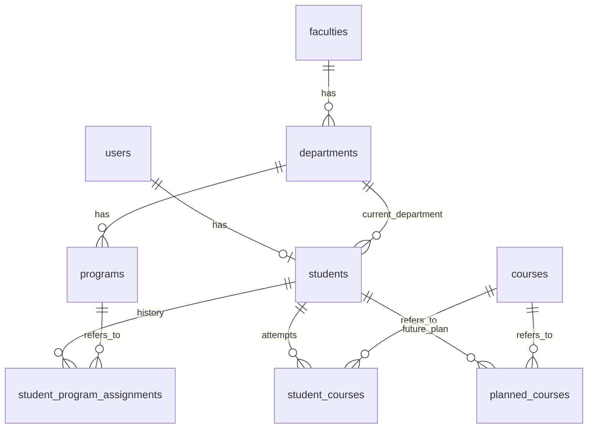

# DB設計と実装状況

## 初期状態（DB設計前の記録）

Ruby 3.4.11 / Rails 8.1.4 / Active Record / pg、Docker ComposeのPostgreSQL 17。
初期schema.rbはversion: 0で業務テーブルなし。既存ModelはApplicationRecordのみ。
DB設計書・ER図、卒業要件JSON、判定ロジックは存在しなかった。
既存テストはHomeControllerとヘルスチェックのシステムテスト。
本番にはSolid Cache / Queue / Cableの別DB設定・各schema.rbがある。
ローカル開発DBのMigration状態にはversion 000のNO FILE行も存在する。
元の空schema.rb（version: 0）のロード由来と考えられるが、既存履歴を尊重して削除していない。

## 採用したモデル

すべてRails標準のbigint主キーとtimestamps。大学側の番号をPKに使わない。

| テーブル | 内容・制約 |
| --- | --- |
| users | email必須、strip/downcaseで正規化、lower(email)に一意index。認証は未実装 |
| faculties | name必須。表示名には一意制約なし |
| departments | faculty必須、name必須 |
| programs | department必須、name必須 |
| students | user必須・一意、department必須（現在所属）、admission_year必須 |
| courses | name必須、course_number任意・非一意、credits任意。curriculum_keyはNULL可・値がある場合は一意 |
| student_courses | student/course/academic_year必須。enrollment_statusはcompleted/registered/in_progress/failed/unknown。semester/grade/credits_earnedはNULL可、approval_confirmedは三値 |
| student_program_assignments | student/program/status必須、assigned_at/ended_at任意 |
| planned_courses | student/course必須、組み合わせは一意。将来科目の一覧として保存し、年度・学期を持たない |
| course_offerings | 科目の学期ごとの開講情報（授業時間配当表の1行）。course/semester（前期・後期）必須。講義コード（学期内で一意）、必修/選択、受講年次（整数配列）、曜日、時限（整数配列）、開講区分（1Q・2Q・半年・集中）は任意。集中講義は曜日・時限なし |
| timetable_uploads / timetable_upload_rows | 講義登録画面でアップロードしたPDFの確認待ちデータ。値はPDFの表記のまま文字列で持ち、確認済みの行だけを保存時にcourses・course_offeringsへ入れ、保存または破棄で消える。PDF本体は保存しない。科目番号・科目名がどちらも完全に一致する既存の講義（被り）がちょうど1件で単位も同じなら、その講義を既定の選択（course_id）にする。複数ある・単位が違う行は未選択のままにし、人が選ぶまで確認済みにできない。「別の講義として登録する」はregister_as_newに持つ。保存できるのは人が確認済みにした行だけ |

外部キーにカスケード削除は指定せず、Modelも履歴がある親のdestroyを拒否する。
データの削除・退会・保持期間は別途仕様が必要。個人情報を永続保持する方針ではない。
入学年度・履修年度は1〜9999の整数。科目の単位(courses.credits)は整数、履修で得た単位(credits_earned)はdecimal(5,2)。いずれも負数禁止。既知の値のみ入力する。
日付は終了日時を設定する場合、開始日時があり終了が開始以降であることを検証する。

## 科目・履修の同一性

- 科目名や番号は同一性の根拠にしない。マスタは独自IDで参照する。
- course_numberは検索用の代表番号。同名・同番号の別科目も許容する。
- 同一科目の複数講義コード・年度別番号は今回のマスタで完全には管理しない。
  実データ入手後、科目IDに紐づく識別子履歴を追加できる。
- 再履修は別のstudent_courses行。student/course/year/semesterも一意にはしない。
  同じ年度・学期の複数履修も許容し、重複入力防止は将来の入力画面で扱う。
- creditsは参考値、credits_earnedはその履修で実際に得た単位。
  マスタ更新は過去のcredits_earnedを書き換えない。
  NULL（未確定）と0（単位取得なし）を区別する。
- 判定はcurriculum_keyで科目を照合し、同一科目の重複を一度だけ算入する。修得単位が競合する再履修や、同等科目の未確認の組合せは「要確認」とし、勝手に最新・最大の記録を採用しない。
- 既存履修行の状態はunknownを既定とし、成績文字列・NULL・年度だけから修得済みや予定とは推測しない。既に修得した科目を将来計画へ重ねても単位は増やさない。

## 所属・配属

配属未確定ならassignment行なしで学生を登録できる。
未確定候補を記録する場合も日時NULLを許容するが、statusの正式な語彙は未定義。
配属変更時は旧行の終了日時を記録して新行を追加できる。複数所属も禁止しない。
statusは文字列（enum未導入）。実際の入力画面を実装する際に語彙・変更操作を確定する。
転学科はstudents.department_idの更新で表現できるが、学科の履歴そのものは未実装。
変更履歴が必要になった時にstudent_department_assignments等を追加する。
過去配属は保存するため、現在学科と過去プログラムの学科の一致は強制しない。

## 卒業要件

年度別分類テーブルは追加しない。CurriculumRepositoryがJSONオブジェクトを返す。
データ形式・エラー契約は[config/curricula/README.md](../config/curricula/README.md)。
2024年度の一次資料で確認した科目をJSONに保存し、明示的なseedでCourseへ登録する。学生の履修データはdb/demo_enrollments.jsonの人工データで、固定デモアカウントにのみ投入する。未確認の数値はNULLと確認理由を保持し、架空の要件を作らない。
GraduationAssessmentが実績・見込みの両方を副作用なしで評価する。要件のJSON Schema、JSONB保存、他年度・コースへの合成は導入していない。

## 安全性

database_safety.rbは開発/テストの接続先をローカルhostと固定DB名に限定する。
db:prepareは両環境を使うためdevelopment起動時にもtestの設定を検査する。
Dockerのdb、localhost、127.0.0.1、::1以外のDBは開発/テストでは使えない。
既存CIのDATABASE_URL（ローカルホスト、DB名なし）も利用可能。
本番は4つの接続URLを必須とし、SSLを必須とする。構成集約は承認待ち。

ログのパラメータフィルターに成績・修得単位・履修情報・DB URLを追加した。
ローカルデモのControllerを追加し、固定デモ学生の履修読出しと、その学生に属する将来計画だけの追加・削除を提供する。利用者指定のstudent_idでは切り替えず、他学生の計画IDによる削除も拒否する。
実アカウントの認証は未実装。デモは開発・テストとローカルホストに限定し、本番・外部からの利用を拒否する。ComposeはWebポートをloopbackへ公開し、明示的なLOCAL_DEMO_PROXY設定時のみプライベートIPのDockerプロキシを許可する。実学生データを扱う前に認証・本人所有チェックを実装する。
SQL debugログ、バックアップ、エラー監視にも機密情報が含まれ得る。
Supabase Data APIの公開対策は[接続手順](supabase.md)を参照。
