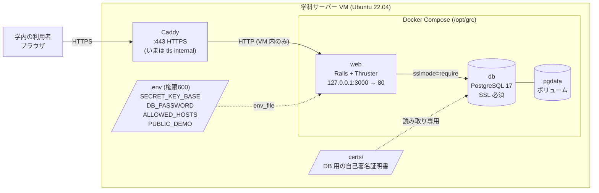
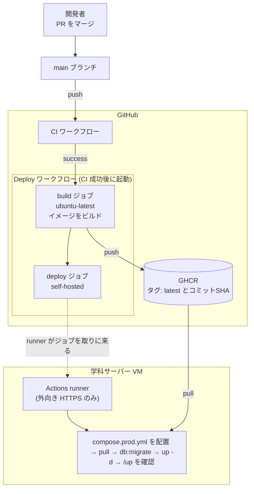

# デプロイの手順とインフラ構成

## 概要

このドキュメントは@ki-mutakuが行った学科サーバーVMへのデプロイ手順とインフラ構成をまとめたドキュメントです。
新学科サーバーやその他サーバーへの移行の際に適宜参照してください。

学内ホスト名と秘密の値(`SECRET_KEY_BASE`、`DB_PASSWORD`、証明書の秘密鍵)は、公開リポジトリに書かないため、このドキュメントでは `<学内ホスト名>` などのプレースホルダーで示します。

## インフラ構成図



## 継続デプロイ(CD)の流れ

main に変更が入ると、CI の成功後に Deploy ワークフローが自動で動きます。



| ジョブ | 実行場所 | 内容 |
|---|---|---|
| build | GitHub のサーバー | イメージをビルドして GHCR に push します。タグは `latest` とコミット SHA の2つです |
| deploy | 学科サーバーの runner | `deploy/compose.prod.yml` を `/opt/grc` に配置し、pull、`db:migrate`、`up -d` を実行して、`/up` で起動を確認します |

フォークからの PR では Deploy が動かないよう、`head_repository` がこのリポジトリのときだけ実行する条件を付けています(`.github/workflows/deploy.yml`)。

## 行ったタスクとコマンド

以降のコマンドは、特に断りがなければ VM 上で実行します。

### 1. Docker のインストール

```sh
sudo apt update && sudo apt -y install ca-certificates curl
sudo install -m 0755 -d /etc/apt/keyrings
sudo curl -fsSL https://download.docker.com/linux/ubuntu/gpg -o /etc/apt/keyrings/docker.asc
echo "deb [arch=$(dpkg --print-architecture) signed-by=/etc/apt/keyrings/docker.asc] https://download.docker.com/linux/ubuntu $(. /etc/os-release && echo $VERSION_CODENAME) stable" | sudo tee /etc/apt/sources.list.d/docker.list
sudo apt update
sudo apt -y install docker-ce docker-ce-cli containerd.io docker-compose-plugin
sudo usermod -aG docker $USER
```

`docker` グループは、ログインし直すまで反映されません。確認は次のコマンドで行います。

```sh
docker --version
docker compose version
```

### 2. 置き場所と DB 用の証明書

```sh
sudo mkdir -p /opt/grc/certs && sudo chown -R $USER /opt/grc
cd /opt/grc/certs
openssl req -new -x509 -days 3650 -nodes -subj "/CN=db" -out server.crt -keyout server.key
sudo chown 999:999 server.key server.crt
sudo chmod 600 server.key
```

`999:999` は、postgres イメージの `postgres` ユーザーです。所有者と権限が違うと、PostgreSQL が秘密鍵を読めず起動しません。

### 3. `.env` の作成

`/opt/grc/.env` を作り、`chmod 600 /opt/grc/.env` を実行します。`DATABASE_URL` は書きません。`compose.prod.yml` が `DB_PASSWORD` から組み立てます。

```sh
RAILS_ENV=production
PORT=80
SECRET_KEY_BASE=<openssl rand -hex 64 の出力>
DB_PASSWORD=<英数字のみのパスワード>
ALLOWED_HOSTS=<学内ホスト名>
PUBLIC_DEMO=1
```

`DB_PASSWORD` に `@` や `:` を入れると、URL として壊れます。英数字だけにします。

### 4. self-hosted runner の登録

GitHub のリポジトリの Settings → Actions → Runners → New self-hosted runner(Linux x64)に表示されるコマンドで、`~/actions-runner` に runner を入れます。そのあと、サービスとして登録します。

```sh
cd ~/actions-runner
sudo ./svc.sh install $USER
sudo ./svc.sh start
```

ユーザーを `docker` グループに入れたあとにサービスを起動する必要があります。順序が逆だと、Deploy が `permission denied ... /var/run/docker.sock` で失敗します。その場合は、次の手順で直します。

```sh
sudo usermod -aG docker $USER
sudo ./svc.sh stop
sudo ./svc.sh start
ps -o user,group,supgrp -p $(pgrep -f Runner.Listener | head -1)
```

### 5. GHCR のイメージを取得できるようにする

Actions が push したパッケージは、最初は private です。VM が `docker compose pull` で取得できるよう、パッケージを public にしました。イメージには秘密の値が入っていません(`.dockerignore` が `.env*` と `config/master.key` を除外しています)。

組織の設定でパッケージの公開が制限されていたため、組織のオーナーが設定を変えました。public にできない場合は、`read:packages` だけを許可した classic PAT で `docker login ghcr.io` する方法もあります。

```sh
read -rs GHCR_TOKEN; echo
echo "$GHCR_TOKEN" | docker login ghcr.io -u <GitHubユーザー名> --password-stdin
unset GHCR_TOKEN
chmod 600 ~/.docker/config.json
```

### 6. Deploy の実行と初回の seed

main への push で Deploy が動きます。失敗したときは、Actions で「Re-run all jobs」を実行します。

seed は初回に1度だけ、手で実行します。Deploy は seed を実行しません。学部・学科の seed は `find_or_create_by!` で書かれているため、2回実行しても重複しません。

```sh
cd /opt/grc
docker compose -f compose.prod.yml run --rm web ./bin/rails db:seed
```

動作は次のコマンドで確認します。

```sh
curl -f http://127.0.0.1:3000/up
docker compose -f compose.prod.yml ps
```

`web` が `Up`、`db` が `healthy` で、`/up` が 200 を返せば、起動できています。

### 7. Caddy のインストールと HTTPS 化

```sh
sudo apt install -y debian-keyring debian-archive-keyring apt-transport-https curl
curl -1sLf 'https://dl.cloudsmith.io/public/caddy/stable/gpg.key' | sudo gpg --dearmor -o /usr/share/keyrings/caddy-stable-archive-keyring.gpg
curl -1sLf 'https://dl.cloudsmith.io/public/caddy/stable/debian.deb.txt' | sudo tee /etc/apt/sources.list.d/caddy-stable.list
sudo apt update && sudo apt install -y caddy
```

`/etc/caddy/Caddyfile` を次の内容にします。ホスト名は `.env` の `ALLOWED_HOSTS` と同じ値です。

```
<学内ホスト名> {
    tls internal
    reverse_proxy 127.0.0.1:3000
}
```

```sh
sudo caddy validate --config /etc/caddy/Caddyfile
sudo systemctl reload caddy
curl -kI https://<学内ホスト名>/up
```

`HTTP/2 200` が返れば、Caddy から Rails まで届いています。`tls internal` は Caddy が作る仮の証明書で、ブラウザには警告が出ます。学内の証明書が届いたら、`tls internal` の1行を `tls <crt のパス> <key のパス>` に差し替えます。

他の端末から開けない場合は、ファイアウォールを確認します。

```sh
sudo ufw status
sudo ufw allow 443/tcp
```

## なぜこの構成にしたか

| 選んだもの | 理由 |
|---|---|
| Docker Compose | 学科サーバーの VM 1台で、web と DB を同じ設定ファイルから起動できます。Kamal のような専用ツールを覚えずに済みます |
| DB を同じ VM の PostgreSQL コンテナに置く | 学生の履修情報を学外のサービスに置かないためです。データは `pgdata` ボリュームに残り、コンテナを入れ替えても消えません |
| DB 接続に SSL を必須にする | 本番では `config/initializers/database_safety.rb` が `sslmode` を `require` 以上に強制します。同じ VM の中でも、この設定に合わせて自己署名証明書で SSL を有効にしました |
| 本番の DB を1つにする | Solid Cache・Queue・Cable 用の DB を分けず、primary の1つにまとめました(PR #55) |
| Caddy を前段に置く | HTTPS の終端を Caddy に任せ、証明書の差し替えを Caddyfile の1行で済ませるためです。Rails は `127.0.0.1` にだけ公開し、外から直接届かないようにしています |
| `ALLOWED_HOSTS` で `config.hosts` を制限する | 想定外のホスト名でのアクセスを Rails が拒否します。`/up` だけは対象から外し、health check が通るようにしています |
| GHCR + GitHub Actions + self-hosted runner | main への push だけでデプロイできます。runner は VM から GitHub へ外向きに接続するため、外から VM に入る口を開けずに済みます |
| イメージを public にする | イメージにはコードと gem とアセットだけが入り、秘密の値は入りません。秘密の値は VM の `.env` にだけ置きます |
| `PUBLIC_DEMO=1` | 認証は未実装のため、当面は架空のデモデータだけを表示します。認証を実装するときに外します |

## 公開前に決めること・残っていること

| 項目 | 状態 |
|---|---|
| 学内の証明書への差し替え | 証明書が届くのを待っています。それまでは `tls internal` です |
| 時間割 PDF の取り込み | 取り込むまで、開講科目の検索は空です。`course_offerings` は seed では作られません |
| バックアップ | 未設定です。`pgdata` ボリュームの定期ダンプを決める必要があります |
| イメージの掃除 | Deploy のたびにイメージが増えます。`docker image prune` を定期的に実行する運用を決める必要があります |
| 認証の実装 | 実装するときに `PUBLIC_DEMO` を外し、seed にパスワード付きのユーザーを入れないようにします |
| `programs` テーブル | seed では作られず、コード内にも作成処理が見つかっていません。出どころは未確認です |
